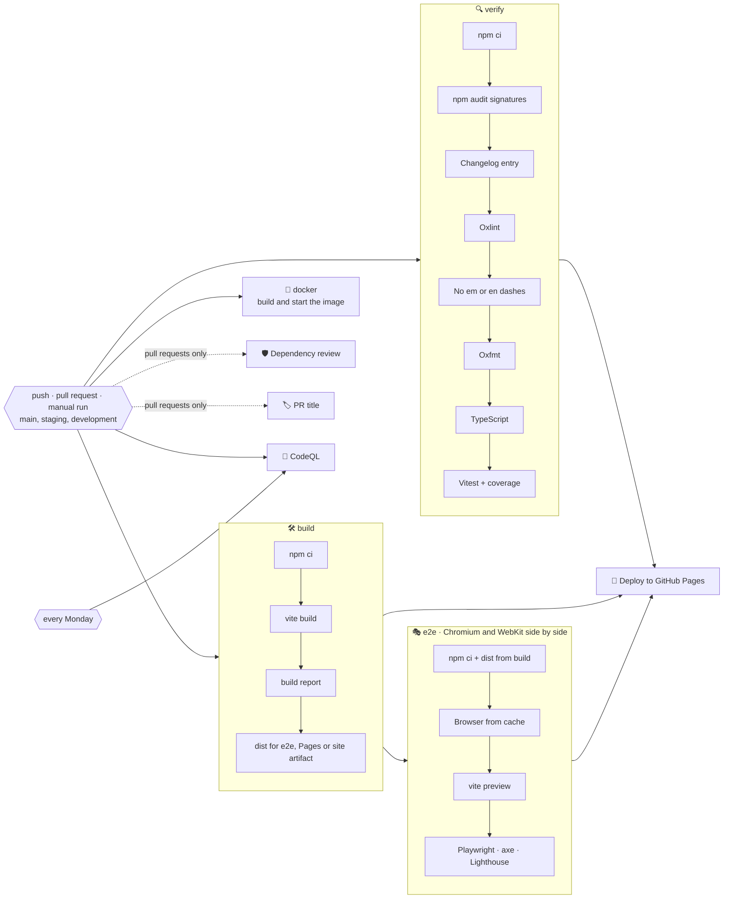
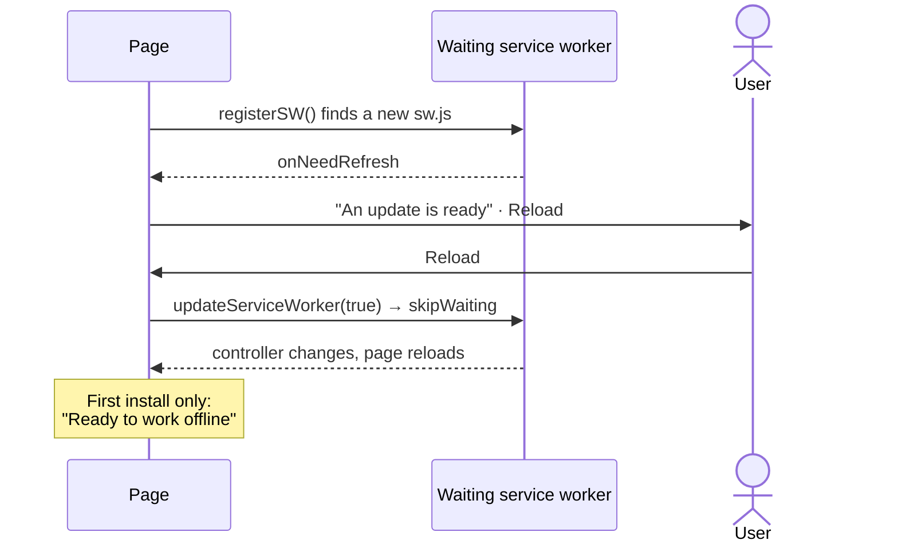

# 🚀 Deployment

Tasks is a static site: the production build in `dist/` is deployed to **GitHub Pages** at <https://tasks.sacrificed.me> by `.github/workflows/ci.yml`, and the same build runs in Docker behind nginx. There is no server, no database and no configuration.

## 🔁 Pipeline



| Job                    | Runs on                       | What it does                                                                                                                                                                                                                                                                                      |
| ---------------------- | ----------------------------- | ------------------------------------------------------------------------------------------------------------------------------------------------------------------------------------------------------------------------------------------------------------------------------------------------- |
| 🔍 `verify`            | every trigger                 | `npm ci`, `npm audit signatures`, a changelog section for the current version, Oxlint with GitHub annotations, no em or en dashes, Oxfmt check, TypeScript, Vitest with coverage, coverage summary and report                                                                                     |
| 🛠️ `build`             | every trigger                 | Production build and `scripts/build-report.mjs`, then uploads `dist/` for `e2e`; on `main` also as the Pages artifact, on `staging` and `development` as the `site-<branch>` artifact                                                                                                             |
| 🎭 `e2e`               | every trigger                 | Two parallel jobs, each with its browser from a cache keyed by the Playwright version, test the `dist/` of `build` in `vite preview`: Chromium on desktop and phone with the Lighthouse budget, and WebKit. Axe, offline, CSP, forced colours and reflow run in both, and each uploads its report |
| 🐳 `docker`            | every trigger                 | Builds the staging image with nginx, Buildx and a layer cache in GitHub Actions from `docker/Dockerfile`, starts it and waits until `/healthz` answers                                                                                                                                            |
| 🏷️ `pr-title`          | pull requests                 | Fails when the title does not follow Conventional Commits, so a squash merge keeps the history readable                                                                                                                                                                                           |
| 🛡️ `dependency-review` | pull requests                 | Fails the pull request if it introduces dependencies with high-severity vulnerabilities                                                                                                                                                                                                           |
| 🔬 `analyze` (CodeQL)  | pushes, pull requests, weekly | Scans TypeScript and the workflow files with the `security-extended` query suite                                                                                                                                                                                                                  |
| 🚀 `deploy`            | `main` pushes and manual runs | Waits for `verify`, `build` and `e2e`, then publishes the artifact to the `github-pages` environment                                                                                                                                                                                              |
| 🔗 `shared`            | Mondays and manual runs       | Checks out weather, faceit-stats and finance and compares the files the four apps share                                                                                                                                                                                                           |
| 📸 `screenshots`       | manual runs                   | Takes the screenshots of the visual tests on Linux and uploads them for a commit, see [Testing](./testing.md#-visual-tests)                                                                                                                                                                       |
| 📡 `monitor`           | hourly, Mondays               | Checks the live site and its Lighthouse scores once `MONITOR_URL` is set, see [Monitoring](#-monitoring)                                                                                                                                                                                          |
| 🏷️ `release`           | `v*.*.*` tags                 | Checks that the tag matches `package.json` and sits on `main`, then publishes the GitHub release with the notes from `CHANGELOG.md` and the Docker image to GitHub Packages, see [Releases](./releases.md)                                                                                        |

Details:

- ⚡ `verify`, `build` and `docker` run in parallel, and `e2e` starts as soon as `build` has uploaded `dist/`, so the tests cover the very bundle that is deployed; deployment requires `verify`, `build` and `e2e` to pass.
- 📏 The build report lists every file with its gzip size on the run's summary page and **fails** the job if the CSP, Trusted Types, the service worker, the manifest shortcuts or the share target are missing, or if an inline script appears.

> [!IMPORTANT]
> A failing end-to-end test, accessibility violation or Lighthouse budget blocks the deployment, so a broken page never reaches GitHub Pages.

- 🛑 Pull request runs cancel superseded runs of the same branch; deployments are never cancelled halfway.
- 🔐 The default token is read-only, checkouts use `persist-credentials: false`, and only the `deploy` job receives `pages: write` and `id-token: write`.
- 🟢 Node.js is installed from `.nvmrc` and npm downloads are cached.

## ⚙️ One-time GitHub setup

1. Open **Settings → Pages** and set **Source** to **GitHub Actions**.
2. Open **Settings → Code security** and enable **Private vulnerability reporting**, **Dependabot alerts** and **Code scanning** (CodeQL uploads its results there).
3. Create `development` and `staging`, make `development` the default branch and protect `main` and `staging` as described in [Releases](./releases.md#️-one-time-github-setup).
4. Push to `main` or start the workflow manually from the **Actions** tab.
5. After the first deployment, add the repository variable `MONITOR_URL` with the address of the live site, `https://tasks.sacrificed.me`, under **Settings → Secrets and variables → Actions → Variables** to turn on the [monitor](#-monitoring).

> [!NOTE]
> The workflow creates the `github-pages` environment on its first run.

## ☁️ Hosting

### 📄 GitHub Pages

`main` deploys to GitHub Pages after every successful run; the `staging` and `development` builds are kept as `site-staging` and `site-development` artifacts, see [Environments](./releases.md#️-environments).

The site lives at the root of its own domain, configured once in `vite.config.ts`:

```ts
const base = "/";
const siteUrl = "https://tasks.sacrificed.me/";
```

`base` feeds the manifest `id`, `scope`, `start_url`, shortcuts and share target. `siteUrl` gives `index.html` its canonical, Open Graph and JSON-LD addresses, and the `site-meta` plugin writes it into `robots.txt` and `sitemap.xml` during the build. To move the app to another domain, change `siteUrl`; to serve it under a sub-path such as `/tasks/`, change `base` too, together with `docker/nginx.conf` and `playwright.config.ts`.

> [!NOTE]
> The custom domain is set once under **Settings → Pages → Custom domain**, with a DNS `CNAME` record from `tasks.sacrificed.me` to `sacrificed666.github.io` and **Enforce HTTPS** turned on. GitHub then redirects the old `sacrificed666.github.io/tasks/` address to the domain. A site deployed by a workflow needs no `CNAME` file.

To deploy by hand, open **Actions → 🚀 Tasks | CI/CD → Run workflow** and choose `main`.

> [!WARNING]
> Runs started on other branches verify, build and test but never deploy.

### 🐳 Docker

The shared service lives in `compose.yaml` at the root, and everything else in `docker/`: one multi-stage `Dockerfile`, an overlay per environment and the nginx configuration. `.dockerignore` keeps `node_modules`, build output, docs and every `.env*` file out of the build context.

| File                      | What it adds                                                                                    |
| ------------------------- | ----------------------------------------------------------------------------------------------- |
| `compose.yaml`            | The `app` service: build context, `docker/Dockerfile` and an init process                       |
| `docker/Dockerfile`       | Stages `base`, `deps`, `development`, `build` and `runtime`, an unprivileged nginx with `dist/` |
| `docker/nginx.conf`       | Security headers, caching, compression, robots rules per environment and a `/healthz` check     |
| `docker/development.yaml` | The Vite dev server with hot reload through Compose Watch, port 5173                            |
| `docker/staging.yaml`     | The production build with `APP_ENV=staging`, port 8081                                          |
| `docker/production.yaml`  | The production build with `APP_ENV=production`, port 8080                                       |

```bash
docker compose -f compose.yaml -f docker/development.yaml up --watch
docker compose -f compose.yaml -f docker/staging.yaml up --build -d
docker compose -f compose.yaml -f docker/production.yaml up --build -d
```

The same with `make`:

```bash
make dev-up                  # [DEV] development with hot reload
make stage-up                # [STAGE] staging in the background
make stage-logs              # [STAGE] follow its logs
make prod-up                 # [PROD] production in the background
make prod-down               # [PROD] stop it, after typing yes
make status                  # which environments are running
```

- 🌐 **The same addresses as on GitHub Pages.** The app lives at the root, and unknown paths fall back to `index.html`.
- 🧭 **`APP_ENV` decides indexing.** For every value except `production`, nginx sends `X-Robots-Tag: noindex, nofollow` and answers `/robots.txt` with `Disallow: /`.
- 🗃️ **Caching.** Hashed files in `assets/` are cached for a year as `immutable`; `index.html`, the service worker and the manifest are revalidated on every visit, so an update reaches everyone through the usual update prompt.
- 🛡️ **Headers.** `nosniff`, `DENY` framing, the referrer policy, `Cross-Origin-Opener-Policy` and the permissions policy join the Content Security Policy that ships in `index.html`; text files are compressed with gzip.
- 📦 **The runtime stage is small.** It is `nginxinc/nginx-unprivileged` with the build only (about 85 MB), runs without root on port 8080 and reports its health through `/healthz`.
- 🏗️ **One build for every platform.** The build stages run on the builder's own platform (`--platform=$BUILDPLATFORM`), because `dist/` is the same everywhere; only the nginx stage differs per platform. The release workflow builds arm64 on GitHub's `ubuntu-24.04-arm` runner and amd64 on `ubuntu-latest`, so nothing is emulated, and joins them into one image.
- 🔒 **Locked down.** Staging and production run on a read-only file system, with small `tmpfs` mounts that only the nginx user can write for temporary files, the cache and the generated config. They drop every Linux capability, forbid privilege escalation and get limits of 128 MB of memory, half a CPU and 100 processes.
- 🔢 **Ports** default to 8080 and 8081, so staging and production fit on one host; `APP_PORT` overrides them. Staging and production restart on failure and rotate their logs.

> [!TIP]
> `docker compose -f compose.yaml -f docker/staging.yaml config` prints the merged configuration of an environment before anything is built.

#### 📦 Published images

Every release also publishes the production image to GitHub Packages, for amd64 and arm64, with build provenance and an SBOM:

```bash
docker run --rm --read-only --tmpfs /tmp --publish 8080:8080 ghcr.io/sacrificed666/tasks:1.0.0
```

The image is the `runtime` stage with `APP_ENV=production`; run it with the hardening of `docker/production.yaml` or behind your own proxy.

## 📱 Progressive Web App

`vite-plugin-pwa` generates the manifest and a Workbox service worker during the build; `app/pwa.ts` registers it in production builds.

| Manifest feature      | Value                                                                                      |
| --------------------- | ------------------------------------------------------------------------------------------ |
| 🪟 `display_override` | `window-controls-overlay`, then `standalone`                                               |
| 🚀 `shortcuts`        | **New task** (`?action=new`), **Today** (`?list=today`), **Important** (`?list=important`) |
| 📤 `share_target`     | `GET` with `title`, `text` and `url`, turned into a task by `app/launch.ts`                |
| 🏷️ `categories`       | `productivity`, `utilities`                                                                |
| 🖼️ Icons              | 64, 192 and 512 px PNGs plus a maskable 512 px icon                                        |
| 📸 `screenshots`      | A wide (1280 × 800) and a narrow (780 × 1688) screenshot for the richer install dialog     |

- 📦 **Precache**: HTML, JavaScript (including every language chunk), CSS, the Montserrat font files, icons and the backdrop artwork, so the app starts offline after the first visit.
- 🏳️ **Flags**: the language flags in `public/flags/` are precached with the rest of the app.
- 🖼️ **Runtime cache**: other images use a cache-first strategy (up to 32 entries for a year).
- 🧪 The service worker is not active during `npm run dev`. Use `npm run build && npm run preview` to test offline behaviour.

### 🔄 Update flow

Updates use the **prompt** strategy, so an update never replaces the running app while you work:



## 📡 Monitoring

`.github/workflows/monitor.yml` watches the live site once the repository variable `MONITOR_URL` holds its address. Until then both jobs are skipped.

| Job             | When                       | What it checks                                                                                                                                                                                                                                                                                            |
| --------------- | -------------------------- | --------------------------------------------------------------------------------------------------------------------------------------------------------------------------------------------------------------------------------------------------------------------------------------------------------- |
| 📡 `uptime`     | every hour and manual runs | `scripts/check-live.mjs` loads `/`, `/.well-known/security.txt`, `/sw.js`, `/robots.txt` and `/sitemap.xml`, each up to three times: every answer succeeds, a page has a title, `security.txt` stays valid for 30 more days, and a JSON answer has no error, no empty list and data at most two hours old |
| 🚦 `lighthouse` | Mondays and manual runs    | `scripts/lighthouse-live.mjs` runs Lighthouse on the home page on a phone and a desktop: performance at least 80 and 90, everything else 100. The HTML reports are kept for 30 days                                                                                                                       |

The paths and pages live under `monitor` in `package.json`, so the workflow and `make live` check the same list. Both scripts write a table to the summary of the run and also work locally, for example `node scripts/check-live.mjs https://tasks.sacrificed.me /`.

> [!TIP]
> GitHub emails the person who last changed the schedule when a scheduled run fails, so a failing check works as an alert. GitHub pauses the schedules of a repository without activity for 60 days; a push or a manual run turns them back on.

## 🤖 Dependency updates

`.github/dependabot.yml` checks for updates every Monday:

- 🌱 pull requests target `development`, so updates reach GitHub Pages with the next release;
- 📦 npm minor and patch updates are grouped into one pull request for production and one for development dependencies; major updates arrive separately;
- ⚙️ GitHub Actions updates are grouped into a single pull request;
- 🔒 `@types/node` stays on the major of the oldest Node.js in `engines`, so its major updates wait until `engines` moves;
- 🐳 the base images in `docker/Dockerfile` are updated one by one;
- 📝 commit messages follow the project convention (`chore(deps): …`, `ci(deps): …`, `build(deps): …`).

Every Dependabot pull request goes through the same pipeline, including the dependency review and CodeQL.

## 🖐️ Checking a build locally

```bash
npm run check
npm run build
npm run preview
```

Open `http://localhost:4173`, add a few tasks, switch the language and the theme, go offline in the developer tools and reload: the app keeps working from the service worker.

`npm run test:e2e` does the same automatically, including offline mode, the Content Security Policy, accessibility and the Lighthouse budget.
