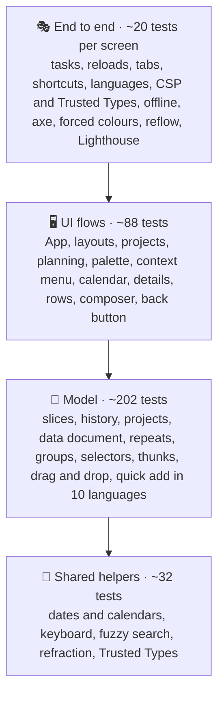
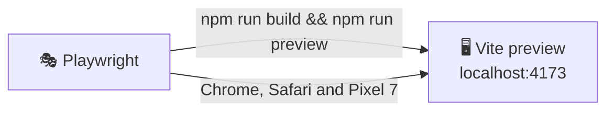

# 🧪 Testing

## 🧰 Stack

| Tool                            | Role                                                                  |
| ------------------------------- | --------------------------------------------------------------------- |
| ⚡ Vitest 5                     | Test runner, configured in `vitest.config.ts`                         |
| 🌐 jsdom 30                     | Browser-like environment                                              |
| 🐙 Testing Library + user-event | Rendering components and simulating real interactions                 |
| 🧩 jest-dom                     | Readable DOM assertions such as `toHaveFocus()`                       |
| 📊 `@vitest/coverage-v8`        | Coverage reports and thresholds                                       |
| 🎭 Playwright                   | End-to-end tests in Chromium and WebKit, on desktop and phone screens |
| ♿ axe-core                     | Accessibility checks inside the end-to-end tests                      |
| 🚦 Lighthouse                   | Performance, accessibility, best practices and SEO budget             |

## ▶️ Running tests

| Command                 | Mode                                                                 |
| ----------------------- | -------------------------------------------------------------------- |
| `npm test`              | 👁️ Unit tests in watch mode                                          |
| `npm run test:run`      | 🧪 Unit tests, single run                                            |
| `npm run test:coverage` | 📊 Unit tests with coverage and thresholds                           |
| `npm run test:e2e`      | 🎭 Production build and preview, then Playwright, axe and Lighthouse |

The HTML coverage report is written to `coverage/index.html`, the Playwright report to `playwright-report/`; open the latter with `npx playwright show-report`.

> [!IMPORTANT]
> Install the browsers for the end-to-end tests once with `npx playwright install chromium webkit`, or `make browsers`.

## 🔺 Shape of the suite

Most behaviour is pinned down by fast unit tests of pure functions and reducers; UI tests render the whole `App` and drive it like a user. The end-to-end tests check what only a real browser can: the production build with its service worker, storage across reloads and tabs, the Content Security Policy, Trusted Types and the finished pages' accessibility.

## 📁 Where tests live

Tests sit next to the code they cover as `*.test.ts(x)`, and every component has its own file in its folder, for example `widgets/Footer/Footer.test.tsx`:

| Area                                     | Files                                                                                    | Covers                                                                                                                                                                                  |
| ---------------------------------------- | ---------------------------------------------------------------------------------------- | --------------------------------------------------------------------------------------------------------------------------------------------------------------------------------------- |
| 🚀 App                                   | `app/App.test.tsx`                                                                       | Shell without a header, smart lists, projects, the phone toolbar, tab bar and Lists sheet, settings, global search, back button, planning, menus, import, export                        |
|                                          | `app/persistence.test.ts`, `app/launch.test.ts`, `app/ErrorBoundary.test.tsx`            | Loading, corrupted data, missing projects, language detection, persistent storage, failed saves, cross-tab sync, URL shortcuts, share target, recovery screen                           |
| ✅ Tasks model                           | `task`, `tasksSlice`, `repeat`, `selectors`, `thunks`, `quickAdd`, `subtasks`            | Parsing and validation, every reducer, anchored repeats, counters and tags, drops on the sidebar, quick add grammar with repeats and `@project` mentions                                |
| ✅ Tasks UI                              | `TaskItem`, `TaskDetailsDialog`, `TaskComposer`, `TaskDnd/dnd`                           | Keyboard commands, completions saved when the page closes mid-animation, the context menu with long press, swipes, chips, the details dialog, quick add, drop rules                     |
| 📁 Projects                              | `project.test.ts`, `projects/thunks.test.ts`                                             | Names and emoji icons, colours, parsing, creating and deleting with undo                                                                                                                |
| 💾 Data                                  | `document`, `history`, `transfer`, `data/thunks`                                         | The stored document and its links, undo and redo of tasks and projects, import limits, export, merging imports                                                                          |
| ⌘ Commands                               | `rank.test.ts`, `CommandPalette.test.tsx`                                                | Ranking and grouping, shortcut, arrow keys, running commands, projects, finding tasks                                                                                                   |
| 📚 Lists, 📊 stats, 🎨 settings, 🌍 i18n | `lists`, `groups`, `sort`, `stats/selectors`, `theme`, `settings`, `thunks`, `translate` | Smart lists and project views, date groups, sort orders, activity, streaks and project progress, backgrounds and glass, the effects level and its old name, language switching, plurals |
| 🧰 Shared                                | `date`, `keyboard`, `motion`, `refraction`, `text`, `trustedTypes`, `Calendar`           | Date keys, labels and week starts, shortcut matchers, transitions, displacement maths, fuzzy search, the URL policy, calendar keyboard navigation                                       |
| 🧩 Widgets                               | `widgets/Footer/Footer.test.tsx`                                                         | The author, the version and the source code, links that announce a new tab                                                                                                              |

## 🌐 Test environment

`src/test/setup.ts` prepares jsdom for the app:

- 🐢 **`matchMedia`** is mocked to report `prefers-reduced-motion: reduce`. The app then skips its delays, transitions and confetti, so tests never wait for animations. Individual tests can override it, for example to render the phone layout with the tab bar.
- 🪟 **Popover API**: jsdom hides `[popover]` elements but cannot open them. `src/test/popover.ts` adds `showPopover()`, `hidePopover()`, `togglePopover()` and `popovertarget` handling, and fires `beforetoggle` and `toggle` events like a browser, so menus that render their content lazily work in tests.
- 🌍 **Translations**: the setup preloads every language with `loadMessages()`, so tests can switch languages synchronously.
- 🗔 **Dialogs**: jsdom has no `showModal()`. `src/test/dialog.ts` implements `show()`, `showModal()` and `close()` with focus on the first control, focus restoration, the `close` event and <kbd>Esc</kbd> handling.
- 👆 **Pointer capture and scrolling**: `setPointerCapture()`, `releasePointerCapture()` and `scrollIntoView()` are stubbed, so swipe and palette tests run unchanged.
- 🧹 **Cleanup**: the DOM is unmounted and `localStorage` is cleared after every test.

Vitest runs with `pool: "vmThreads"`: one jsdom per worker, and every test file in a fresh context of its own, which is about twice as fast as a new process per file. Built-in browser objects such as `location` cannot be redefined in that pool, so code that reloads the page calls a small wrapper that tests spy on instead, `reloadPage()` in `shared/lib/navigation.ts`.

Unit tests run without React Compiler, the same in all four apps, so coverage counts the branches of the source rather than the cache checks the compiler adds. The production build, the end-to-end tests and Lighthouse cover the compiled code. `vite.config.ts` leaves the compiler out while `VITEST` is set.

## 🛠️ Helpers

| Helper                                                      | File                    | Purpose                                                              |
| ----------------------------------------------------------- | ----------------------- | -------------------------------------------------------------------- |
| `renderWithStore(ui, { preloadedState })`                   | `src/test/render.tsx`   | Renders with a fresh store and returns `{ store, user, ...queries }` |
| `renderApp(tasks, list, projects)`                          | `src/test/render.tsx`   | Renders the whole app with the given tasks, view and projects        |
| `openPopover(user, trigger)`                                | `src/test/render.tsx`   | Clicks a popover trigger and returns queries scoped to the panel     |
| `section(name)`, `itemTitles(region)`                       | `src/test/render.tsx`   | Finds a task section and lists the titles in it                      |
| `makeTask()`, `makeProject()`, `makeState()`, `sampleTasks` | `src/test/factories.ts` | Consistent fixtures                                                  |
| `todayKey()`, `dayFromToday(offset)`                        | `src/test/factories.ts` | Due dates relative to the current day                                |

## 📐 Conventions

- 🎯 Query by role and accessible name (`getByRole("button", { name: "Delete “Buy milk”" })`). If an element is hard to find this way, it is probably hard to use with a screen reader too.
- 🖱️ Drive the UI with `userEvent`. Use `fireEvent` only for low-level input that user-event cannot express, such as touch swipes.
- 👀 Test behaviour, not implementation: assert on what the user sees or on the store, never on component state.
- 🌍 Assert translated text through `formatMessage(createTranslator(locale), message)` in model tests, so both languages are checked without rendering.
- 🫥 Popover content is in the DOM even while closed; scope queries with `openPopover()` or ignore it with `{ ignore: "[popover] *" }`.
- ⏱️ Long presses and other timers use `vi.useFakeTimers()` with `act()`, and real timers are restored at the end of the test.
- 🔢 Pure logic that a component needs, such as drop rules or collision detection, lives in a plain module next to it (`TaskDnd/dnd.ts`) so it can be tested without a browser.
- 🌐 Browser-only behaviour that cannot be asserted automatically (refraction, pointer light, the backgrounds, dragging onto the sidebar and rendering speed) is verified in Chrome; its pure logic is unit tested.
- 🎭 In Playwright, choose styled radio buttons through their label with `option(page, name)`, seed tasks with `seed(page)`, run palette commands with `runCommand(page, name)` and list cut-off texts with `clippedText(page)` from `e2e/helpers.ts`.

## 🎭 End-to-end tests

`playwright.config.ts` builds the app and serves it with `vite preview` at the root, so the tests see the same files as GitHub Pages, with the injected Content Security Policy and the service worker. In CI the `e2e` jobs download `dist/` from the `build` job and set `E2E_PREBUILT=true`, so Playwright only starts the preview and tests the very bundle that is deployed.

> [!TIP]
> Locally the preview server is reused when it is already running, so after the first run a repeated `npx playwright test e2e/accessibility.spec.ts` takes seconds. Rebuild with `npm run build` after changing the app.

| Spec                       | Checks                                                                                                                                                                                                                                                                         |
| -------------------------- | ------------------------------------------------------------------------------------------------------------------------------------------------------------------------------------------------------------------------------------------------------------------------------ |
| ✅ `tasks.spec.ts`         | Quick add, tasks kept after a reload, completing with undo, a completion saved while it is still animating, tab sync, app shortcuts and shared text                                                                                                                            |
| 🌍 `languages.spec.ts`     | Starting in the browser's language (Ukrainian and Czech, with a Czech quick add), switching in the settings and keeping it after a reload                                                                                                                                      |
| 🛡️ `security.spec.ts`      | No console errors or CSP violations during a session, the policy in place and Trusted Types blocking `innerHTML`                                                                                                                                                               |
| ✈️ `offline.spec.ts`       | The service worker takes over, and the app reloads, shows the offline badge and accepts new tasks without a network                                                                                                                                                            |
| ♿ `accessibility.spec.ts` | axe on the main views, dialogs and the palette in both appearances and in Ukrainian, the full effects of Apple devices, the skip link with the keyboard, forced colours, reflow at 320 px and no word cut off at 360 px in Ukrainian, Polish and Portuguese, settings included |
| 🔎 `seo.spec.ts`           | Robots rules and the sitemap, the description, canonical and Open Graph tags filled in from `vite.config.ts`, JSON-LD, the share image, every icon and the manifest                                                                                                            |
| 📸 `visual.spec.ts`        | Screenshots of the tasks of today in both appearances and on a phone, compared on Linux only                                                                                                                                                                                   |
| 🚦 `lighthouse.spec.ts`    | The Lighthouse budget below                                                                                                                                                                                                                                                    |

CI runs the browsers as two parallel jobs, `npx playwright test --project=lighthouse` for Chromium on desktop and phone with the visual tests and Lighthouse, and `npx playwright test --project=webkit`; both commands work locally too.

Every spec except Lighthouse runs in **Desktop Chrome** and in **Desktop Safari** on WebKit, the engine of every browser on Apple devices, and every spec except SEO and Lighthouse also on a **Pixel 7** screen. In Safari, <kbd>Tab</kbd> skips links unless the setting is on, so the keyboard test presses <kbd>Option</kbd>+<kbd>Tab</kbd> there. Service workers are blocked except in the offline spec, so a cached build never hides a change, and flags are served from `public/flags`, so the tests never depend on another site. The accessibility checks run with reduced motion, so transitions never catch axe halfway, and they also enable two axe rules that are off by default: `label-content-name-mismatch`, so a visible label always matches what voice control users say, and `target-size`, so every control is at least 24 × 24 px or far enough from its neighbours (WCAG 2.2, 2.5.8).

> [!NOTE]
> On Linux, as on the CI runners, the WebKit project browses with the user agent of Safari on Linux. WebKit there paints without a GPU, and the blurred glass and moving sky that Apple devices get would stall it until clicks time out, while Safari on Linux gets the lighter effects of every system but Apple's, as visitors with it do. The specs about Apple effects set a Mac user agent themselves, and a run on a Mac keeps the Mac agent everywhere.

### 📸 Visual tests

`e2e/visual.spec.ts` compares screenshots of the tasks of today in both appearances and on a phone with the files in `e2e/__screenshots__/`. The tasks are seeded at a fixed time, Monday 15 June 2026 at 09:00 in Kyiv. Fonts and anti-aliasing differ from one system to another, so screenshots are only taken and compared on the Linux runners of GitHub Actions: the `visual` project exists when `CI` or `VISUAL` is set, and the Chromium job of `e2e` runs it before Lighthouse.

1. 📸 After a change in the design, start the **Screenshots** workflow (`.github/workflows/screenshots.yml`) from the **Actions** tab.
2. 📥 Download its `screenshots` artifact and unpack it into `e2e/__screenshots__/`.
3. 📝 Commit the new files together with the change.

> [!NOTE]
> Until `e2e/__screenshots__/` exists, the visual tests load the pages without comparing anything (`ignoreSnapshots`). A screenshot may differ in at most 1% of its pixels, and the HTML report of a failed run shows the expected, the actual and the difference side by side.

### 🚦 Lighthouse budget

| Page              | Form factor | Performance | Accessibility | Best practices | SEO | Page weight |
| ----------------- | ----------- | ----------: | ------------: | -------------: | --: | ----------: |
| 📥 `/`            | 🖥️ Desktop  |      ≥ 0.90 |             1 |              1 |   1 |    ≤ 280 KB |
| 📥 `/`            | 📱 Mobile   |      ≥ 0.80 |             1 |              1 |   1 |    ≤ 280 KB |
| ☀️ `/?list=today` | 🖥️ Desktop  |      ≥ 0.90 |             1 |              1 |   1 |    ≤ 280 KB |

Every audit of the accessibility category must pass as well, including the ones Lighthouse does not weigh into the score. Each run attaches the full Lighthouse HTML report to its test in the Playwright report.

> [!NOTE]
> Locally the app scores 1 on desktop and 0.95 for performance on mobile, with 242 KB transferred; the score thresholds leave room for slower CI machines. Each page weight limit sits about 35 to 40 KB above what the page weighs today, the same rule in all four apps, so a heavier dependency or a bigger prefetch fails the build early; lower the limits again when a page gets lighter.

## 📊 Coverage thresholds

`npm run test:coverage` fails when coverage drops below:

| Metric        | Threshold |
| ------------- | --------: |
| 📄 Statements |      94 % |
| 🔀 Branches   |      89 % |
| 🧩 Functions  |      94 % |
| 📏 Lines      |      96 % |

The suite currently covers about 95 % of statements, 90 % of branches, 95 % of functions and 97 % of lines. Each threshold sits about a point below the current coverage, the same rule in all four apps, so a change can only keep or raise it; raise them again when new tests add a point. The CI pipeline runs the same command, publishes a coverage table on the workflow summary page and uploads the HTML coverage and Playwright reports.
